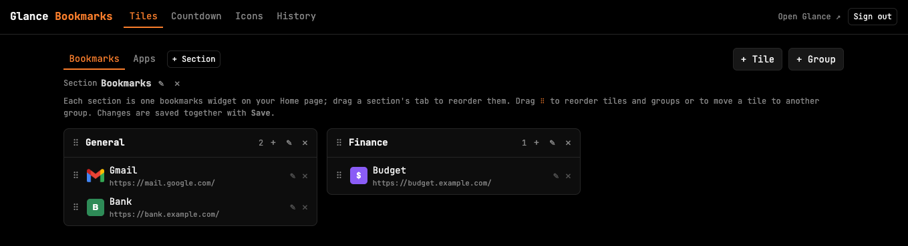
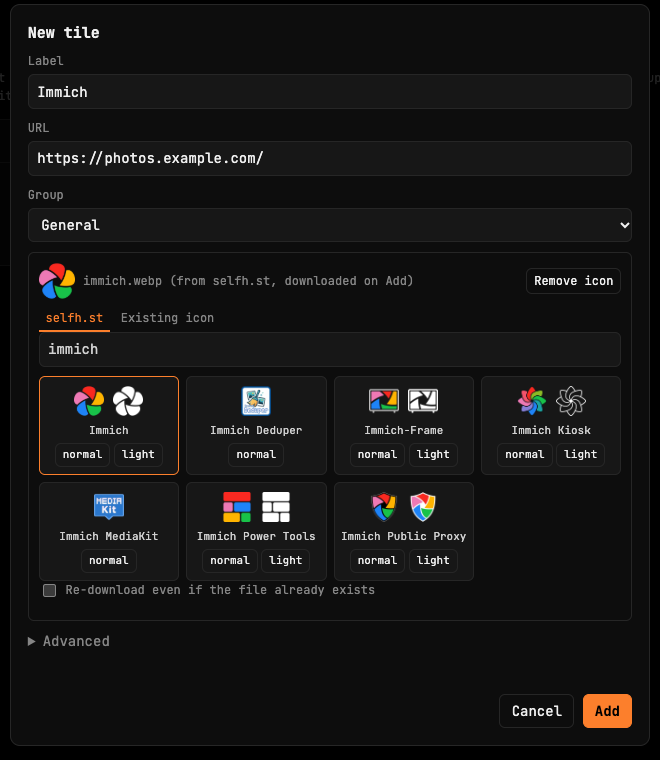

<h1 align="center">Glance Bookmarks Editor</h1>
<p align="center">
  <a href="#features">Features</a> •
  <a href="#how-it-works">How it works</a> •
  <a href="#requirements">Requirements</a> •
  <a href="#install">Install</a> •
  <a href="#documentation">Docs</a> •
  <a href="#security">Security</a>
</p>

<p align="center">Edit the bookmarks on your self-hosted <a href="https://github.com/glanceapp/glance">Glance</a> dashboard from a browser,<br>
instead of editing YAML. Every change is checked by Glance before it goes live.</p>



## Features

- **Bookmarks.** Every bookmarks widget on your Home page shows up as a section. Add, edit, delete and drag tiles
  between groups. Add, rename and reorder groups and whole sections.
- **Icons.** Search [selfh.st/icons](https://selfh.st/icons) by name, with a live preview and light variants.
  The editor downloads the icon into Glance's assets for you.
- **Safe saves.** Each save runs `glance config:validate` on a copy first. If Glance rejects the change, nothing is
  written and you see Glance's error.
- **History.** The last 30 versions are kept, with a diff and one-click restore.
- **Countdown (optional).** Birthdays and events for the Countdown widget that comes with the editor.
- **Small.** Python 3 standard library plus `python3-yaml`, and one vanilla JS page. No database, no build step,
  no Node, no pip.

<details>
<summary><strong>Picking an icon</strong></summary>
<br>



</details>

## How it works

The editor never rewrites your whole config. Your bookmarks widgets move into a file of their own,
`local/links.yml`, and your Home page pulls them back in with Glance's `$include`:

```
glance.yml
└─ pages/home.yml
   ├─ local/links.yml          ← your bookmarks (the editor writes this)
   └─ widgets/countdown.yml    ← optional
      └─ local/countdown.yml   ← countdown dates (the editor writes this)
```

Everything else stays yours: pages, theme and other widgets. Edit them by hand, or with scripts or AI agents, as
long as `local/` is left alone. The installer does the move for you and checks that your dashboard looks exactly
the same afterwards. [Config layout](docs/config-layout.md) explains each file and why it's split this way.

## Requirements

- **Glance v0.8.7 or newer**, run as a native binary by a systemd unit named `glance`, on Debian or Ubuntu. The
  [Proxmox VE helper script](https://community-scripts.github.io/ProxmoxVE/scripts?id=glance) sets it up this
  way. The Glance Docker image and Alpine aren't supported.
- **Root** on that machine or container, and about 150 MB of free disk space.
- **An HTTPS reverse proxy** such as Nginx Proxy Manager, Caddy or nginx. The login only works over HTTPS.
- **Outbound HTTPS** to `raw.githubusercontent.com`, for icons.

## Install

New to this? Follow the **[setup guide](docs/setup-guide.md)**. It goes step by step from a fresh helper-script
Glance to a working editor behind HTTPS, with every command.

The short version, as root on the Glance machine:

1. **Lay out the config:** your Home page in `pages/home.yml`, with at least one bookmarks widget. The
   [starter config](examples/glance_data) shows the shape.
2. **Download, preview, install:**

   ```bash
   cd /root
   curl -fsSL https://github.com/wevibevasxal/glance-bookmarks-editor/releases/latest/download/glance-bookmarks-editor.tar.gz | tar xz
   apt-get update && apt-get install -y python3 python3-yaml
   ./glance-bookmarks-editor/install.sh --plan        # shows what will change; changes nothing
   GE_TRUSTED_PROXY=<proxy-ip> GE_PUBLIC_URL=https://<editor-hostname>/ \
     ./glance-bookmarks-editor/install.sh --migrate   # moves the bookmarks, installs, asks for a password
   ```

3. **Put it behind HTTPS:** point a proxy host at `http://<glance-ip>:5000`, then sign in as `admin`.

## Documentation

| Guide | What's in it |
|---|---|
| [Setup guide](docs/setup-guide.md) | From a Proxmox VE helper-script Glance to a working editor: config layout, install, HTTPS proxy, firewall |
| [Config layout](docs/config-layout.md) | Which file is which, who edits what, and why |
| [Using the editor](docs/using.md) | Sections, tiles, icons, countdown and history |
| [Maintenance](docs/maintenance.md) | Update, password reset, restore, rebuild, troubleshooting, uninstall |
| [Reference](docs/reference.md) | Settings, commands, how saves work, security details |
| [Development](docs/development.md) | Tests and release builds |

## Security

- **One admin login:** PBKDF2 password hash, an HTTPS-only `SameSite=Strict` session cookie, CSRF tokens and a
  login rate limit.
- **Icons only from selfh.st:** a fixed URL pattern. No uploads and no arbitrary URLs.
- **It runs as root**, so that it can validate with Glance's root-only `.env` and write into the Glance folder.
  Treat it as an admin tool: reach it only through your HTTPS proxy, and allow port 5000 only from that proxy.

More in [Reference → Security](docs/reference.md#security).

## Credits

- [Glance](https://github.com/glanceapp/glance) by svilenmarkov
- Icons from [selfh.st/icons](https://selfh.st/icons)
- [SortableJS](https://github.com/SortableJS/Sortable) (MIT) and [JetBrains Mono](https://github.com/JetBrains/JetBrainsMono)
  (OFL) are included in `app/static/vendor/`

## License

[MIT](LICENSE)
